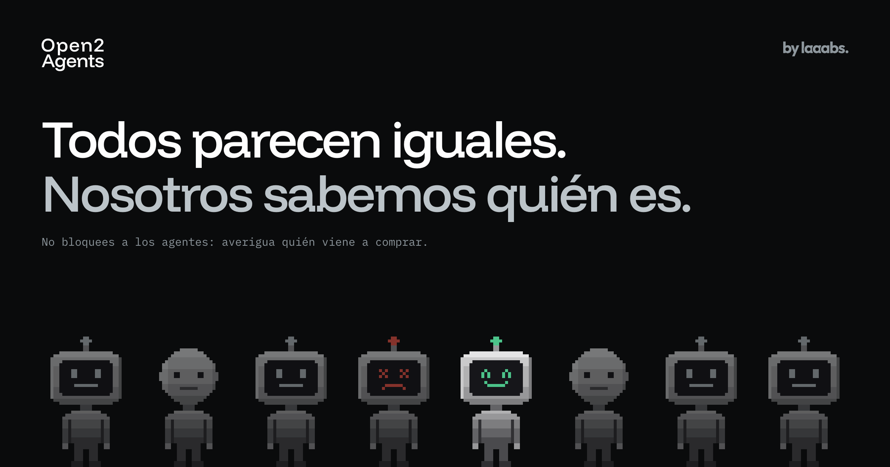
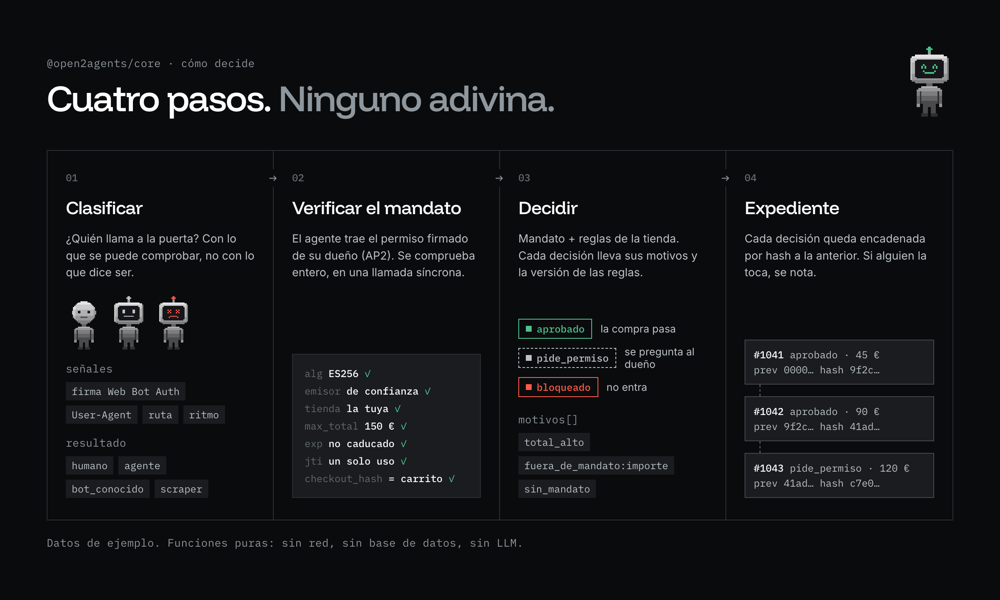
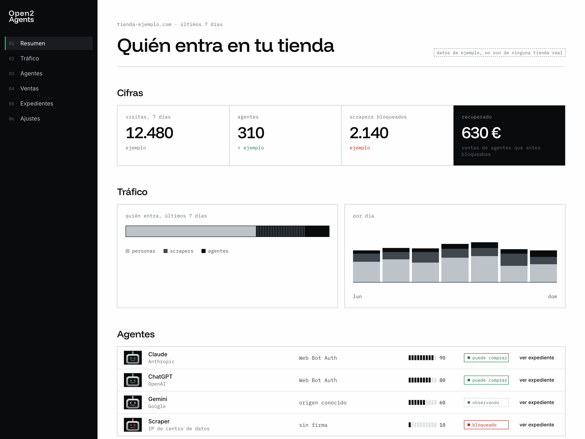
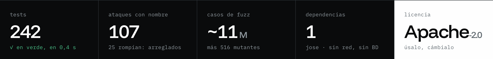

  
  
  

 

Cada vez más compras las hace **un agente de IA en nombre de alguien**. Para tu tienda, ese agente se parece mucho a un scraper: los dos son programas, los dos navegan sin ratón. Hoy se bloquea a los dos, y con el scraper se va también la venta.

**Open2Agents** distingue en tu tienda a las personas, a los scrapers y a los agentes que vienen a comprar. Al scraper le cierra el paso; al agente, se lo abre.

<table>
  <tr>
    <td align="center" width="33%"> <b>Persona</b> Compra como siempre. No nota nada.</td>
    <td align="center" width="33%"> <b>Scraper</b> Se le cierra el paso.</td>
    <td align="center" width="33%"> <b>Agente que compra</b> Se le abre, con el permiso firmado de su dueño.</td>
  </tr>
</table>

 

 

### Lo que verá la tienda

Concepto del panel, con datos de ejemplo.

 

### El núcleo es abierto

Quien decide si una compra pasa tiene que poder auditarse. Por eso [**open2agents/core**](https://github.com/open2agents/core) es público: funciones puras en TypeScript, Apache-2.0, y todo lo que intentamos para romperlo, escrito.

 

Nació en Start Camp 2026, que ganamos. Ahora es una startup. <b>by laaabs.</b>

